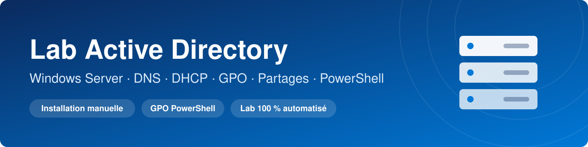
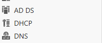
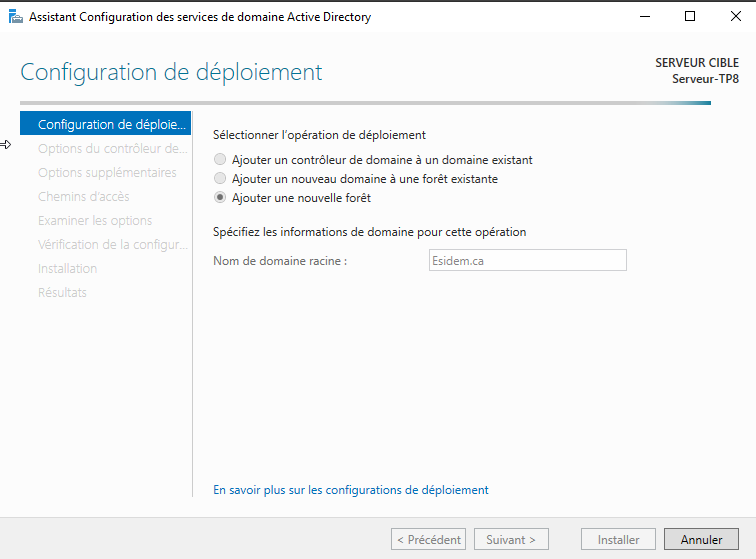
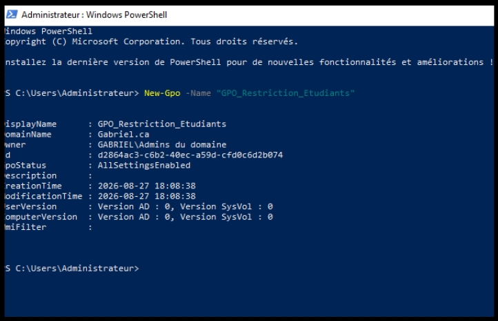
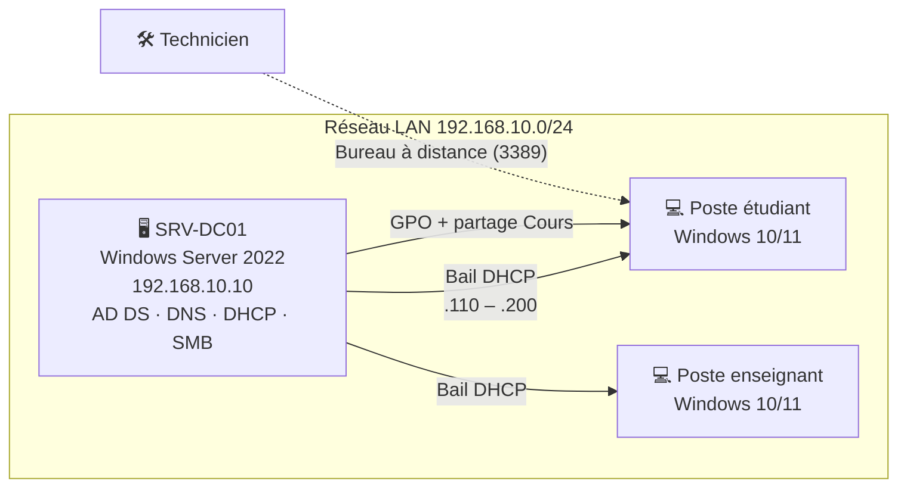
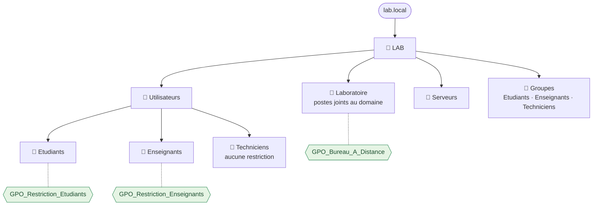

<p align="center"></p>

# Lab Active Directory — Windows Server

Laboratoire Windows Server : domaine Active Directory avec DNS et DHCP, GPO de restriction liées aux unités d'organisation, partage de fichiers avec droits par groupe et création d'utilisateurs en masse depuis un CSV en PowerShell.

Réalisé dans le cadre du cours **Serveurs et gestion de l'accès** (DEP Soutien informatique, ESIDEM Montréal), puis transposé en scripts PowerShell (voir [À propos de ce portfolio](#à-propos-de-ce-portfolio) pour savoir qui a fait quoi).

<p>
  
  
  
  
  
</p>

## Aperçu

| Rôles installés | Nouvelle forêt | GPO créée en PowerShell |
|:---:|:---:|:---:|
|  |  |  |

## Parcours

| Étape | Contenu | Documentation |
|---|---|---|
| 🖱️ 1. Installation manuelle | VM Windows Server, IP fixe, rôles AD DS / DNS / DHCP, forêt `Esidem.ca`, étendue DHCP, premier utilisateur — en interface graphique | [TP 8.1 avec captures](docs/tp8-installation-manuelle.md) |
| ⌨️ 2. GPO en PowerShell | `New-GPO`, `New-GPLink`, `Set-GPRegistryValue` : restriction du Panneau de configuration pour les étudiants et les enseignants | [TP GPO PowerShell](docs/tp-gpo-powershell.md) |
| ⚙️ 3. Lab automatisé | Déploiement complet d'un laboratoire scolaire `lab.local` par scripts : OU, comptes en masse, GPO, partage `Cours`, Bureau à distance | Ci-dessous |

## Scénario du lab automatisé

Un laboratoire d'enseignement : les postes doivent rejoindre un domaine centralisé et recevoir automatiquement leur configuration réseau. Les étudiants ouvrent une session avec leur compte de domaine, consultent les documents du dossier partagé **Cours** en lecture seule et subissent des restrictions sur les postes. Les enseignants alimentent ce dossier, et les techniciens administrent les postes à distance.



| Élément | Valeur |
|---|---|
| Domaine / NetBIOS | `lab.local` / `LAB` |
| Contrôleur de domaine | `SRV-DC01` — `192.168.10.10/24`, passerelle `192.168.10.1` |
| DNS | Zone directe `lab.local` et zone inverse `10.168.192.in-addr.arpa` (intégrées à AD), redirecteurs `1.1.1.1` et `8.8.8.8` |
| DHCP | Étendue `192.168.10.100 – 200`, exclusion `.100 – .109`, bail 8 jours, options 003 (passerelle), 006 (DNS) et 015 (domaine) |
| Partage | `\\SRV-DC01\Cours` |

### Structure Active Directory et GPO



| GPO | Liée à | Paramètres |
|---|---|---|
| `GPO_Restriction_Etudiants` | `OU=Etudiants` | Panneau de configuration interdit · outils Registre interdits · invite de commandes interdite · stockage USB interdit |
| `GPO_Restriction_Enseignants` | `OU=Enseignants` | Panneau de configuration interdit |
| `GPO_Bureau_A_Distance` | `OU=Laboratoire` | Bureau à distance activé avec NLA · règle de pare-feu entrante TCP 3389 (profil Domaine) |

Les GPO de restriction ne contiennent que des paramètres *Utilisateur* et sont donc liées aux OU des **comptes**. La GPO Bureau à distance ne contient que des paramètres *Ordinateur* et est liée à l'OU des **postes**. Dans chaque GPO, la partie inutilisée est désactivée.

### Partage « Cours »

| Groupe | Partage (SMB) | NTFS | Effet |
|---|---|---|---|
| Etudiants | Lecture | Lecture et exécution | Consultent les documents sans pouvoir les modifier ni les supprimer |
| Enseignants | Modifier | Modification | Déposent et mettent à jour les documents |
| Administrateurs | Contrôle total | Contrôle total | Administration |

L'héritage NTFS est coupé et le groupe *Utilisateurs* est retiré, ce qui donne le moindre privilège : personne d'autre n'a accès. L'énumération basée sur l'accès masque le partage à ceux qui n'y ont pas droit.

## Contenu du dépôt

```
├── scripts/
│   ├── 01-Install-ADDS.ps1        IP statique, renommage, installation AD DS + création de la forêt
│   ├── 02-Configure-DNS.ps1       Zone inverse, PTR du DC, redirecteurs
│   ├── 03-Configure-DHCP.ps1      Rôle DHCP, autorisation AD, étendue, options, exclusions
│   ├── 04-Create-OUs.ps1          OU, groupes de sécurité, redirection des nouveaux ordinateurs
│   ├── 05-Import-Users.ps1        Création des comptes depuis le CSV
│   ├── 06-Configure-GPO.ps1       Création, paramétrage et liaison des GPO
│   ├── 07-Configure-Partage.ps1   Dossier partagé Cours (SMB + NTFS)
│   └── 08-Verification.ps1        Contrôle de l'état du lab
├── data/
│   └── utilisateurs.csv           Jeu de données fictif (6 étudiants, 2 enseignants, 2 techniciens)
└── docs/
    ├── tp8-installation-manuelle.md
    ├── tp-gpo-powershell.md
    ├── verification.md            Tests côté serveur et côté client, problèmes courants
    └── captures/
```

## Déploiement

Sur un Windows Server fraîchement installé, dans une console PowerShell **administrateur** :

```powershell
Set-ExecutionPolicy -Scope Process Bypass
cd .\scripts

.\01-Install-ADDS.ps1 -Etape Preparation     # redémarre le serveur
.\01-Install-ADDS.ps1 -Etape Promotion       # crée la forêt, redémarre le serveur

.\02-Configure-DNS.ps1
.\03-Configure-DHCP.ps1
.\04-Create-OUs.ps1
.\05-Import-Users.ps1 -CheminCsv ..\data\utilisateurs.csv -WhatIf   # simulation
.\05-Import-Users.ps1 -CheminCsv ..\data\utilisateurs.csv
.\06-Configure-GPO.ps1
.\07-Configure-Partage.ps1
.\08-Verification.ps1
```

Toutes les valeurs (nom de domaine, adresses, étendue, OU…) sont des paramètres des scripts. Par exemple, pour reproduire le TP 8.1 :
`.\01-Install-ADDS.ps1 -Etape Preparation -NomServeur Serveur-TP8 -AdresseIP 192.168.1.20 -Passerelle 192.168.1.1`.

Les scripts sont **idempotents** : relancés, ils ne recréent ni OU, ni groupe, ni compte, ni GPO, ni lien déjà présents.

## Import des utilisateurs

Format du CSV (séparateur `;`, UTF-8) :

```csv
Prenom;Nom;Service;Fonction;Telephone
Chloé;Dubois;Etudiants;Etudiante DEP Soutien informatique;
```

Le script `05-Import-Users.ps1` :
- génère l'identifiant `prenom.nom` (accents retirés, 20 caractères maximum) et ajoute un suffixe numérique en cas d'homonyme ;
- place le compte dans l'OU de son profil et l'ajoute au groupe de sécurité correspondant ;
- demande le mot de passe initial au lancement (il n'est jamais écrit dans le CSV) et impose son changement à la première connexion ;
- ignore les comptes déjà existants et affiche un bilan créés / ignorés / erreurs ;
- supporte `-WhatIf` pour une simulation.

## Validation

Voir [docs/verification.md](docs/verification.md) : santé du DC (`dcdiag`), résolution DNS directe et inverse, bail DHCP sur le client, jonction au domaine, restrictions testées avec un compte de chaque profil (`gpresult /r`), droits sur `\\SRV-DC01\Cours` et connexion Bureau à distance.

## Compétences mises en œuvre

Windows Server · Active Directory Domain Services · DNS · DHCP · unités d'organisation et groupes de sécurité · stratégies de groupe (GPO) · partages SMB et permissions NTFS · Bureau à distance · PowerShell (`ActiveDirectory`, `GroupPolicy`, `DnsServer`, `DhcpServer`, `SmbShare`, `NetSecurity`) · automatisation et idempotence · documentation technique.

## À propos de ce portfolio

| Réalisé par moi, Caleb Ebanda | Réalisé avec l'aide de Claude (assistant IA d'Anthropic) |
|---|---|
| Les TP en machine virtuelle : installation de Windows Server, configuration IP, rôles AD DS / DNS / DHCP, forêt, étendue DHCP, comptes utilisateurs | La rédaction et la mise en forme de la documentation (README, pages des TP, guide de vérification) |
| Le TP GPO en PowerShell, réalisé en classe : création, liaison et paramétrage des GPO | La bannière, les badges et les schémas |
| Les captures d'écran | Les scripts du dossier `scripts/`, écrits par Claude à partir du scénario de mon cours pour automatiser ce que j'ai fait à la main. **Je ne les ai pas encore exécutés sur un serveur.** |

Les manipulations, les choix de configuration et les résultats des TP sont les miens. Claude m'a aidé à les documenter et à les présenter.

