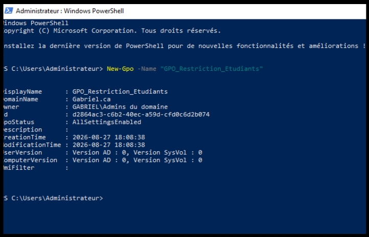
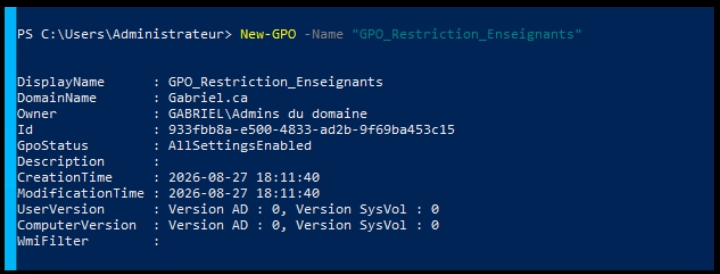
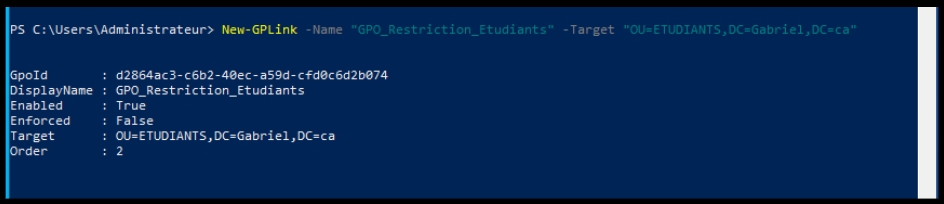
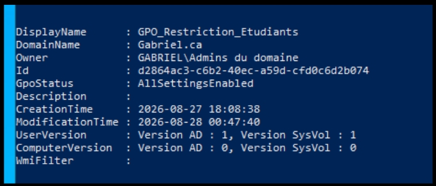

# TP — Création de GPO avec PowerShell

Suite du TP 8.1, sur les mêmes machines virtuelles (contrôleur de domaine Windows Server + client Windows 10/11 joint au domaine). Objectif : créer, lier et configurer des stratégies de groupe **uniquement en ligne de commande** avec le module `GroupPolicy`.

> Les captures ont été réalisées en classe sur la machine virtuelle de laboratoire commune (domaine `Gabriel.ca`, OU `ETUDIANTS`). Les commandes écrites ci-dessous reprennent la structure du lab automatisé (`OU=…,OU=Utilisateurs,OU=LAB,DC=lab,DC=local`) : adaptez la partie `DC=` à votre domaine.

## 1. Créer les GPO

```powershell
New-GPO -Name "GPO_Restriction_Etudiants"
New-GPO -Name "GPO_Restriction_Enseignants"
```

`New-GPO` renvoie l'objet créé : `UserVersion` et `ComputerVersion` sont à `0`, la GPO est encore vide.




## 2. Lier chaque GPO à la bonne OU

```powershell
New-GPLink -Name "GPO_Restriction_Etudiants"   -Target "OU=Etudiants,OU=Utilisateurs,OU=LAB,DC=lab,DC=local"
New-GPLink -Name "GPO_Restriction_Enseignants" -Target "OU=Enseignants,OU=Utilisateurs,OU=LAB,DC=lab,DC=local"
```



Points d'attention :
- `-Target` attend le **nom distinctif (DN) exact** de l'OU, avec `DC=` pour chaque partie du domaine. Une faute dans le DN donne une erreur « objet introuvable ».
- Bien vérifier que **chaque GPO est liée à son OU** : lier deux fois la même GPO à deux OU différentes est une erreur facile à faire en copiant-collant la commande.
- `Get-GPInheritance -Target "<DN de l'OU>"` affiche les liens d'une OU pour contrôler.

## 3. Désactiver le Panneau de configuration

Le paramètre *Configuration utilisateur → Modèles d'administration → Panneau de configuration → Interdire l'accès au Panneau de configuration et à l'application Paramètres du PC* correspond à une valeur de registre que l'on écrit dans la GPO :

```powershell
foreach ($gpo in "GPO_Restriction_Etudiants", "GPO_Restriction_Enseignants") {
    Set-GPRegistryValue -Name $gpo `
        -Key "HKCU\Software\Microsoft\Windows\CurrentVersion\Policies\Explorer" `
        -ValueName "NoControlPanel" -Type DWord -Value 1
}
```

Après cette commande, `Get-GPO -Name "GPO_Restriction_Etudiants"` montre `UserVersion : Version AD : 1, Version SysVol : 1` : la partie Utilisateur a bien été modifiée et répliquée dans SYSVOL.



## 4. Tester sur le client Windows 10/11

```powershell
gpupdate /force          # applique immédiatement les GPO
gpresult /r /scope user  # liste les GPO appliquées à l'utilisateur connecté
```

1. Se connecter avec un compte de l'OU **Etudiants** → ouvrir le Panneau de configuration : message *« Cette opération a été annulée en raison des restrictions en vigueur sur cet ordinateur »*.
2. Même test avec un compte de l'OU **Enseignants** → même restriction.
3. Avec un compte **Techniciens** → aucun blocage (aucune GPO de restriction liée à cette OU).

## Version automatisée

Le script [`scripts/06-Configure-GPO.ps1`](../scripts/06-Configure-GPO.ps1) reprend ces étapes de façon rejouable (il ne recrée pas une GPO ou un lien déjà existants) et ajoute d'autres restrictions pour les étudiants (Registre, invite de commandes, clés USB) ainsi que l'activation du Bureau à distance sur les postes du laboratoire.
