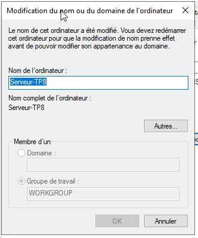
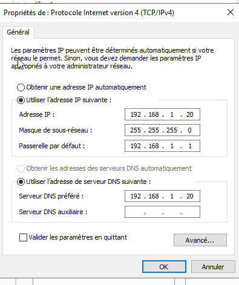
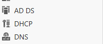
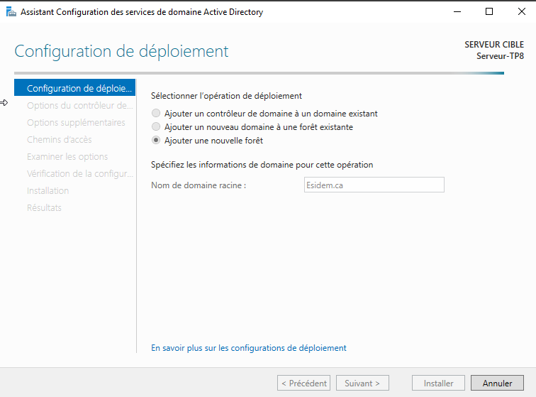
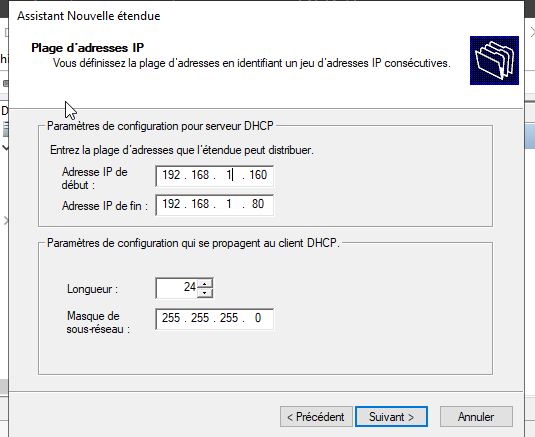
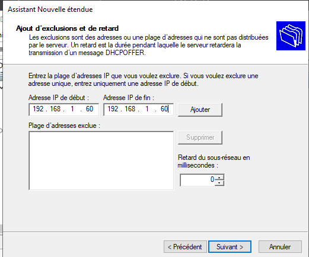
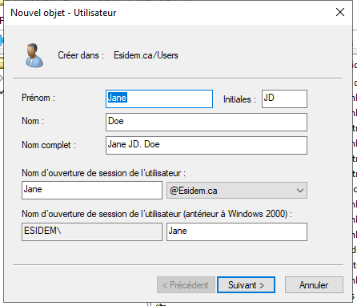

# TP 8.1 — Installation manuelle d'AD DS, DNS et DHCP

Première partie du lab, réalisée **en interface graphique** (Gestionnaire de serveur) sur une machine virtuelle Windows Server, dans le cadre du cours *Serveurs et gestion de l'accès* (DEP Soutien informatique, ESIDEM Montréal).

## Machine virtuelle

| Paramètre | Valeur |
|---|---|
| Nom de la VM | `WIN-SRV-TP8` |
| Mémoire | 4 Go |
| Disque | 50 Go |
| Système | Windows Server 2019/2022 64 bits |

## 1. Nom du serveur

Le serveur est renommé **`Serveur-TP8`** avant toute installation de rôle (le nom d'un contrôleur de domaine ne doit plus changer ensuite).

## 2. Adresse IP statique

Un contrôleur de domaine et un serveur DHCP doivent avoir une adresse fixe. Le serveur pointe vers **lui-même** comme DNS, puisqu'il va héberger la zone du domaine.

| IP | Masque | Passerelle | DNS |
|---|---|---|---|
| `192.168.1.20` | `255.255.255.0` | `192.168.1.1` | `192.168.1.20` |

## 3. Ajout des rôles

Rôles installés depuis *Gérer → Ajouter des rôles et fonctionnalités* : **AD DS**, **DHCP** et **DNS**.

## 4. Promotion en contrôleur de domaine

Assistant de configuration AD DS → **Ajouter une nouvelle forêt**, domaine racine **`Esidem.ca`**.

## 5. Étendue DHCP

Création d'une étendue IPv4 distribuant les adresses **`192.168.1.60` à `192.168.1.80`** en /24, puis ajout d'une exclusion.

## 6. Premier utilisateur du domaine

Création du compte **Jane Doe** dans *Utilisateurs et ordinateurs Active Directory* (conteneur `Esidem.ca/Users`).

## Ce que j'en retiens

- L'ordre compte : **nom → IP fixe → rôles → promotion**. Renommer ou changer l'IP d'un DC après coup casse les enregistrements DNS.
- Le DNS du serveur doit pointer vers lui-même : sans cela, les clients et le DC ne trouvent pas les enregistrements SRV du domaine.
- Un serveur DHCP doit être **autorisé dans Active Directory** avant de distribuer des baux.
- Les comptes créés dans le conteneur `Users` par défaut ne peuvent pas recevoir de GPO dédiées : d'où, dans la suite du lab, une structure en **unités d'organisation**.

La suite du lab automatise et pousse plus loin ces mêmes étapes en PowerShell : voir le [README](../README.md).
